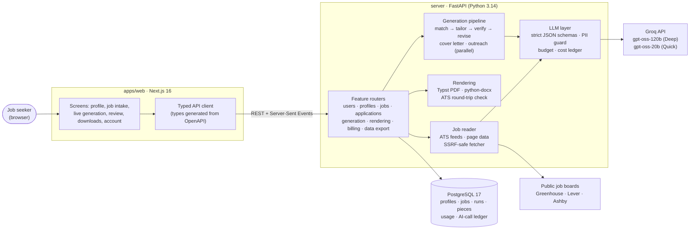
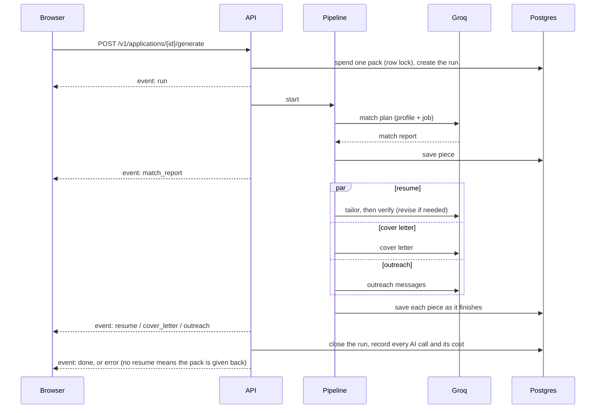

# Tailor (working name): an AI job-application copilot

Upload your resume once. For any job (a link or the pasted description), Tailor writes, in seconds:

- **a resume tailored to that job**, as PDF or Word, read back the way an applicant-tracking system (ATS) reads it
  before you download it, so you can see exactly what the robot sees;
- **a cover letter** (PDF, Word or copy-paste);
- **outreach messages**: a recruiter email, a LinkedIn connection note, a referral ask and a follow-up.

Everything it writes comes from your own experience. Every resume bullet cites the facts in your profile it is based
on, an AI fact-checker reviews the draft, and gaps are surfaced as questions, never filled in. Your name, email and
phone never reach the AI: it writes placeholders that are filled in when the document is made.

> **Status:** the backend (8 parts) and the web app are built and tested: 236 backend tests plus 5 eval-harness tests, and
> web unit tests, typecheck and build, all in CI. It runs end to end locally against the real AI (Groq). It is not deployed yet,
> and real sign-in, payments and the free match scan are still to come. See
> [what's done](docs/engineering/WORK_DONE.md) and [what's left](docs/engineering/WORK_LEFT.md).

## How it works

1. **Profile.** You upload your resume; the AI turns it into a versioned list of facts (roles, achievements, numbers,
   skills). Contact details are stored separately.
2. **Job.** You paste a link or the description. Public job boards (Greenhouse, Lever, Ashby) are read from their
   official feeds; LinkedIn, Indeed and Naukri are never scraped from our servers (you paste the text instead).
3. **Match.** The AI maps each job requirement to the facts that prove it: shown, partly shown, or a gap.
4. **Write.** The resume, cover letter and outreach are written in parallel and streamed to the screen as each one
   finishes. The resume is fact-checked and rewritten once if anything isn't supported by your profile.
5. **Check and download.** The resume is rendered to PDF (fitted to one or two pages) and Word, then read back by two
   independent text extractors. You see the measured result, which job keywords were found and the plain text a parser gets.

## Architecture



How one "Generate" press flows (the pieces arrive on screen one by one):



The full as-built design (data model, every module, security, CI/CD) is in
[docs/engineering/ARCHITECTURE.md](docs/engineering/ARCHITECTURE.md). The original design and the parts still planned
(AWS, workers, S3, the browser extension) are in [docs/ARCHITECTURE.md](docs/ARCHITECTURE.md).

## Run it locally

You need Python 3.14 and [uv](https://docs.astral.sh/uv/), Docker (for Postgres), and Node 24 (pnpm comes through
corepack). A [Groq](https://console.groq.com) API key is needed for anything that calls the AI; tests don't need one.

```bash
uv sync
```

```bash
docker compose up -d db
```

```bash
uv run python -m alembic upgrade head
```

```bash
uv run python -m uvicorn app.main:app --reload --port 8000
```

```bash
corepack pnpm install
```

```bash
corepack pnpm dev:web
```

Open http://localhost:3000 and sign in with any email (development sign-in). Put `GROQ_API_KEY=...` in a `.env` file
at the repo root (see `.env.example`; it is gitignored). On Windows machines where Application Control blocks uv's
launcher, follow the commands in [CLAUDE.md](CLAUDE.md) instead (`py -m venv .venv`, then `.venv/Scripts/python.exe ...`).

Checks:

```bash
uv run python -m pytest -q
```

```bash
corepack pnpm --filter web typecheck
```

[CONTRIBUTING.md](CONTRIBUTING.md) has every command, the branch and pull-request workflow, and the rules `main` enforces.

## Repository map

`✓` built and tested · `○` planned (the folder's README says what lands there and when).

```
.
├── apps/
│   ├── web/                       ✓ Next.js web app (sign-in, profile, jobs, live generation, review, downloads, account)
│   └── extension/                 ○ Chrome extension: "Tailor this job" side panel
├── packages/
│   ├── api-types/                 ✓ TypeScript types generated from the API's OpenAPI schema (CI checks they're current)
│   └── ui/                        ○ shared React components, once the extension needs them
├── server/
│   ├── app/
│   │   ├── core/                  ✓ config, logging (PII redaction), errors, request ids, database, sign-in tokens, SSE
│   │   ├── llm/                   ✓ the only code that calls Groq: client, model router + prices, schemas, PII guard,
│   │   │                            prompts (versioned by content hash), style linters, cost ledger
│   │   ├── features/
│   │   │   ├── users/             ✓ automatic sign-up, GET/DELETE /v1/me
│   │   │   ├── profiles/          ✓ resume upload → parsed, versioned profile; contact details
│   │   │   ├── jobs/              ✓ jobs from text or links, shared cache, no-scraping rule
│   │   │   ├── applications/      ✓ start, list, read applications with their latest pack
│   │   │   ├── generation/        ✓ the pipeline and the streaming generate endpoint
│   │   │   ├── rendering/         ✓ PDF (Typst) and DOCX, ATS round-trip check, downloads
│   │   │   ├── billing/           ✓ plans, entitlements, usage metering (payments not yet)
│   │   │   └── data_export/       ✓ GET /v1/me/export
│   │   ├── api/                   ✓ route collection, health, dev-only sign-in
│   │   └── cli/                   ✓ dev tokens, plan grants, OpenAPI export, Phase 0 concierge tool
│   ├── migrations/                ✓ Alembic (4 migrations, 10 tables)
│   ├── tests/                     ✓ pytest against real Postgres, with a fake Groq
│   └── Dockerfile                 ✓ the API image (published to GHCR by CD)
├── templates/                     ✓ Typst templates: resume (classic, modern), cover letter
├── evals/                         ✓ 12 synthetic resume × job cases with fabrication traps, graders, model bake-off
├── infra/terraform/               ○ AWS infrastructure as code
├── .github/                       ✓ CI, CD, evals workflows, Dependabot, PR template
├── docs/                          product, market, architecture, costs, roadmap, ADRs, engineering handover
├── .claude/                       Claude Code subagents and skills used to build this repo
├── docker-compose.yml             local Postgres 17 on port 5433
└── CLAUDE.md                      working rules and commands
```

## Documentation

| Read this | For |
|-----------|-----|
| [docs/engineering/ARCHITECTURE.md](docs/engineering/ARCHITECTURE.md) | How the built system works, module by module, with diagrams |
| [docs/engineering/WORK_DONE.md](docs/engineering/WORK_DONE.md) | Everything built so far, part by part, with decisions and known limits |
| [docs/engineering/WORK_LEFT.md](docs/engineering/WORK_LEFT.md) | The prioritised backlog with scope, acceptance criteria and where to start |
| [CONTRIBUTING.md](CONTRIBUTING.md) | Setup, commands, branch and PR workflow, CI/CD, the protected `main` |
| [docs/PRD.md](docs/PRD.md) · [docs/MARKET.md](docs/MARKET.md) | What we're building, for whom; competitors and risks |
| [docs/ARCHITECTURE.md](docs/ARCHITECTURE.md) · [docs/adr/](docs/adr/) | The original design, including what's planned, and decision records |
| [docs/COSTS.md](docs/COSTS.md) · [docs/ROADMAP.md](docs/ROADMAP.md) | Unit economics and pricing; phases and go-to-market |
| [docs/design-system/tailor/](docs/design-system/tailor/) | The web app's design tokens and rules |

## Non-negotiables

1. **Never fabricate.** Every generated bullet cites the profile facts behind it and passes the fact-checker.
2. **Contact details never go to the AI.** Placeholders are filled in when documents are made.
3. **"ATS-safe" is measured** on every file, never claimed with made-up scores.
4. **No server-side scraping** of LinkedIn, Indeed, Naukri or other client-only sites.
5. **Prompt, schema or model changes ship with eval results.** Fabrication = 0 and ATS parse = 100% are hard gates.
