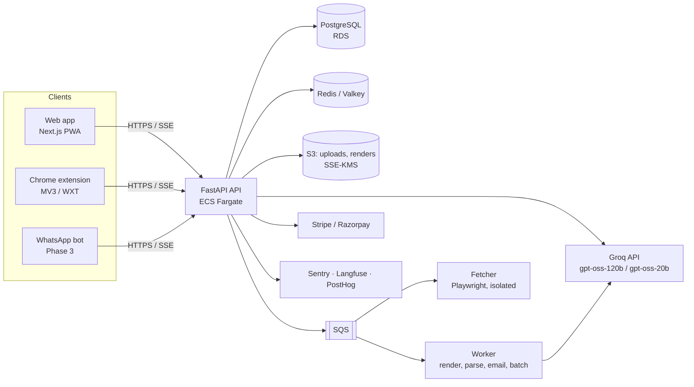
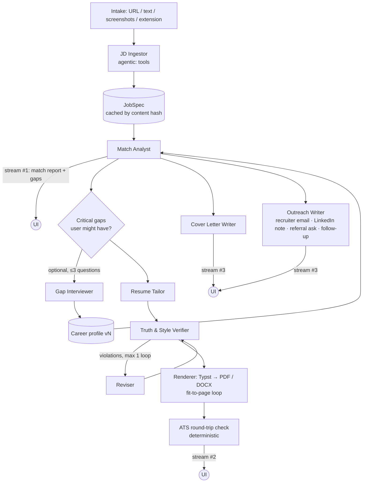

# Architecture: "Tailor" (working name)

The full system design: the generation pipeline, clients, data model, security, infrastructure and how it gets deployed.
Product scope lives in [PRD.md](PRD.md), money in [COSTS.md](COSTS.md), and sequencing in [ROADMAP.md](ROADMAP.md).

> This is the design, including parts not built yet (AWS, workers, S3, the extension, payments). What exists in the
> code today is described in [engineering/ARCHITECTURE.md](engineering/ARCHITECTURE.md).

---

## 1. Design principles (the decisions everything else follows)

| # | Principle | Why |
|---|-----------|-----|
| 1 | **A workflow, with agents only where they pay.** Code drives a fixed pipeline (DAG). The LLM decides things only in three places: fetching a job from a hard URL, asking the user about gaps, and the editor copilot. | It's faster, cheaper, predictable and testable. An open-ended agent loop adds latency and cost without a better resume. |
| 2 | **Structured data in, structured data out.** The LLM reads and writes JSON that matches Pydantic schemas. It never produces layout, HTML or PDF. | Deterministic rendering, diffable edits, measurable quality. |
| 3 | **Never fabricate.** Every tailored bullet points to the profile facts it came from. A skill the user doesn't have gets *asked about*, never invented. | One invented skill in an interview destroys trust in the product. It also sets us apart from competitors that hallucinate. |
| 4 | **The master profile is the moat.** One growing, structured "career profile" per user, enriched by every gap question answered. Resumes are *views* of it. | It compounds over time, gets better with use and creates switching cost. |
| 5 | **Contact details never go to the LLM.** Name, email, phone and address are swapped for placeholders before any model call and put back at render time. | This minimizes PII, and DPDP/GDPR compliance gets easier. |
| 6 | **"ATS-safe" is checked, not claimed.** Every PDF is parsed back with real extraction libraries before the user sees an "ATS check passed" badge. | Marketing a vague "ATS score" is a liability and a trust risk (see §8). |
| 7 | **Show something within ~3–5 s.** Stream progress and results step by step (match report first, then resume, then letters). | "Instant" is a feeling: perceived latency matters more than total latency. |
| 8 | **Boring, cheap infrastructure until scale forces otherwise.** | Most of the money goes to LLM tokens and marketing, not servers. |

---

## 2. System overview



| Component | Responsibility | Tech |
|-----------|----------------|------|
| Web app | Onboarding, job intake, live generation view, editor with diff, tracker, billing | Next.js (App Router) + TypeScript, Tailwind + shadcn/ui, TanStack Query, PWA (Web Share Target) |
| Chrome extension | "Tailor for this job" button on job pages; reads the JD from the page the user is viewing | WXT (MV3), shares UI components with web |
| API | Auth verification, orchestration of the generation pipeline (SSE), CRUD, billing webhooks | FastAPI (async), Pydantic v2, SQLAlchemy 2 async + asyncpg, Alembic |
| Worker | Non-interactive jobs: resume upload parsing, DOCX/PDF bulk renders, emails, nightly evals, cleanup | Same codebase as the API, different entrypoint, consumes SQS |
| Fetcher | Headless-browser fallback for JS-rendered job pages. Isolated because it runs untrusted pages | Playwright + Chromium, separate ECS service, no DB access |
| LLM | Extraction, matching, writing, verifying | Groq via the `groq` Python SDK (`AsyncGroq`): gpt-oss-120b (Deep), gpt-oss-20b (Quick), qwen3.8-27b (preview) for screenshots. See §4.4 and [ADR-0001](adr/ADR-0001-llm-provider-groq.md) |

---

## 3. Core user flows (summary; details in PRD)

1. **Onboard (one time, ~60 s):** upload a resume (PDF/DOCX/image, or a LinkedIn "Save to PDF" export) → parse → **career profile** → 3–5 quick enrichment questions (missing metrics, tools) → done.
2. **Intake a job:** paste a URL, paste text, upload 1–3 screenshots, use the browser extension, or share to the PWA (Android) → **JobSpec**.
3. **Generate the application pack:** match report → tailored resume → cover letter → outreach messages, streamed as each piece finishes.
4. **Review & edit:** side-by-side diff against the base resume, with the reason for each change; accept or reject per bullet; copilot instructions ("make it one page", "more senior tone").
5. **Download:** PDF (default) and DOCX, using the file name `First-Last-Resume-Company.pdf`.
6. **Track:** the application moves through draft → applied → interview → offer/rejected. The outcomes feed the quality flywheel.

---

## 4. The generation pipeline

### 4.1 DAG



The orchestrator is plain Python `asyncio`: a small DAG runner with per-step checkpoints in Postgres (`generation_runs` / `artifacts`). A failed step can be retried without redoing the steps before it. **No agent framework** (LangGraph, CrewAI, etc.) is needed: the graph is static and short.

### 4.2 Steps, contracts and models

| Step | Input → Output (Pydantic schema) | Default model / effort | Notes |
|------|----------------------------------|------------------------|-------|
| JD Ingestor | URL / text / images → `JobSpec` | gpt-oss-120b `low` (tool use) for URLs; one structured call for text; qwen3.8-27b (vision, preview) for screenshots, with local OCR as the fallback | Tools: `fetch_ats_api`, `fetch_html`, `render_with_browser`, `request_screenshot_from_user`. See §5 |
| Resume Parser (onboarding) | PDF/DOCX/image → `CareerProfile` + `StyleProfile` + enrichment questions | gpt-oss-120b `medium` | Groq has no PDF input. Text is extracted locally (pdfminer.six / pypdf, python-docx; OCR for scanned files in Phase 1), keeping headings and bullets as layout hints |
| Match Analyst | `CareerProfile` + `JobSpec` → `MatchReport` (requirement ↔ evidence map split into **basic/required vs. preferred** qualifications, gaps, keyword plan, angle) | gpt-oss-120b `medium` | First thing streamed to the UI. It mirrors how employer-side AI grades (Workday HiredScore A–D against basic and preferred qualifications; Ashby per-criterion "meets"). It writes the shared prompt cache that the following steps read (§4.5) |
| Gap Interviewer | `MatchReport.gaps` → ≤3 yes/no/short questions → new facts | gpt-oss-120b `low` | Optional and never blocking: "Generate now" vs "Answer 3 quick questions" |
| Resume Tailor | profile + JobSpec + MatchReport → `TailoredResume` (sections, bullets with `source_fact_ids`, `targets_requirement_ids`) | gpt-oss-120b `medium` | Chooses and orders bullets, rewrites in the user's voice, sets length by region and seniority |
| Truth & Style Verifier | `TailoredResume` + profile → `Violations[]` | gpt-oss-120b `medium` **plus** deterministic linters (`server/app/llm/style/linters.py`) | Linters: banned phrases, every bullet has ≥1 `source_fact_id`, numbers present in the source, tense, length |
| Reviser | resume + violations → resume | gpt-oss-120b `medium` | At most 1 loop. Anything still flagged is shown to the user, never silently shipped |
| Cover Letter Writer | profile + JobSpec + MatchReport → `CoverLetter` | gpt-oss-120b `medium` | 250–350 words. Specific to the company, from facts in the JD |
| Outreach Writer | same → `OutreachPack` (recruiter email, LinkedIn note ≤200 chars, referral ask, follow-up) | gpt-oss-120b `low` | |
| Renderer | `TailoredResume` + template → PDF/DOCX | — (deterministic) | Typst (§8) |
| ATS round-trip | PDF → `AtsCheck` | — (deterministic) | §8 |
| Editor Copilot | resume JSON + instruction → JSON patch ops | gpt-oss-120b `low` (tools: `update_bullet`, `reorder`, `remove`, `set_length_target`) | Agentic, interactive |

`reasoning_effort` (low/medium/high) is the cost and latency control, set per step in `server/app/llm/router.py`. Reasoning tokens are billed as output but not downloaded (`include_reasoning: false`). The table shows **Deep** mode. The router is keyed by `(step, mode)`:
- **Deep** (paid): gpt-oss-120b on every step, about **$0.017 per full pack**.
- **Quick** (free tier and scans): gpt-oss-20b on every step, about **$0.008 per pack** and roughly 2× faster. It's **the same pipeline with the same linters, verifier and truthfulness gates**, just a different model.
- The Phase 0 bake-off (`evals/run_eval.py`) decides the final split, including whether the preview qwen3.8-27b writes enough better to justify ~5× the cost.

Changing a step's model is a one-line change in `router.py`, never in feature code, and it's gated by the eval set (§10). Why Groq: [ADR-0001](adr/ADR-0001-llm-provider-groq.md). Costs: [COSTS.md §1–2](COSTS.md).

### 4.3 Latency budget (target p50)

| Moment | Target | How |
|--------|--------|-----|
| JobSpec ready | 2–4 s (0 s on a cache hit) | ATS public APIs before HTML before browser. Cache by URL and content hash |
| Match report visible | ≤ 6 s | Sent as one SSE event when the step finishes (Groq can't stream structured outputs). Meanwhile the UI shows a step-progress checklist |
| Resume PDF ready | ≤ 20 s | Tailor → lint + verify → (revise) → render (~100 ms) → ATS check (~200 ms) |
| Cover letter + outreach | ≤ 25 s, in parallel | Starts as soon as the match report is cached |
| Quick mode: the whole pack | ≤ 10 s | The same DAG on gpt-oss-20b |

If even faster output is needed, the levers are Quick mode or a lower `reasoning_effort` on the Tailor step. Groq has no separate fast tier, because its LPU inference already is the fast tier.

### 4.4 LLM integration rules (enforced by the `llm-pipeline-standards` skill)

- One `GroqLLM` wrapper (`server/app/llm/client.py`) around the official `groq` SDK. Feature code calls `run_step(step, output=Schema, ...)` and gets a validated Pydantic object back.
- **Strict structured outputs** (`response_format: {type: json_schema, strict: true}`) for every step. Schemas come from Pydantic through `strict_json_schema()`: every field required, optional means nullable, every object closed.
- **No token streaming:** Groq doesn't support streaming together with structured outputs, so progress streams to the UI per step instead.
- **Truncation:** `finish_reason == "length"` (often long reasoning) raises `StepTruncated`. Partial JSON is never parsed as success.
- **Prompts are files** (`server/app/llm/prompts/<step>.md`). The version is a content hash, so it can't go stale. Every `llm_calls` row records `prompt_version`, model, tokens (including cached and reasoning), cost, latency and finish reason.
- **Budget guard:** a per-user, per-day token ceiling and a per-run cost ceiling enforced in the wrapper. A run that exceeds it fails closed.
- **Prompt-injection posture:** JD text and uploaded resumes are *untrusted data*. They're wrapped in delimited blocks; the system prompt says instructions inside them are ignored; outputs are schema-constrained; the Verifier flags anything that doesn't come from the profile. Hidden or white-text keyword stuffing in user uploads is stripped, never copied forward.
- For SDK specifics, check the Groq docs (console.groq.com/docs) and the installed `groq` package. **Don't write SDK calls from memory:** the Groq catalog and parameters change often.

### 4.5 Prompt caching layout (where the money is)

Every step shares the same byte-stable prefix:

```
[system: global policy — truthfulness, voice, banned phrases, output rules]  ← cached, shared by all users
[user block 1: CareerProfile vN (placeholders, no contact info)]             ← cached per user (automatic prefix cache)
[user block 2: step-specific instructions + JobSpec + MatchReport]           ← uncached
```

- Groq caches prefixes automatically on gpt-oss models: cached input is 50% off, with no write fee, and entries expire after ~2 h idle. There are no cache markers to manage, but the prefix still has to stay byte-stable.
- The Match Analyst runs first and warms the cache. Tailor, Cover Letter and Outreach then run in parallel and read it.
- Profile JSON is serialized with sorted keys and compact separators, and nothing volatile (timestamps, IDs) goes in the prefix.
- Watch `usage.prompt_tokens_details.cached_tokens` (the `cached_tokens` column in the ledger). A drop to zero means something is invalidating the prefix.

### 4.6 Human-sounding output, without "AI-detector evasion"

The goal is writing a recruiter believes. "Fooling detectors" is not a goal: those detectors are unreliable anyway. The rules live in the `resume-tailoring` skill and are compiled into the global system prompt:
- Use a **style profile** taken from the user's own resume (sentence length, verb habits, how they write numbers) and stay close to it.
- Ban the AI clichés ("spearheaded", "leveraged", "results-driven", "passionate about", "dynamic", "synergy", "delve", "tapestry", em-dash chains, triads everywhere). The ban is enforced by a deterministic linter, not just the prompt.
- Every bullet should be concrete: an action, the object and the result with a number when the source has one. Vary the structure, and allow plain verbs.
- Cover letters name one concrete thing about the company that comes from the JD, never a generic "I'm excited to apply".

---

## 5. Job description ingestion

Order of attempts (the first success wins). The agentic ingestor only steps in when the fast paths fail:

| # | Source | How | Notes |
|---|--------|-----|-------|
| 1 | **Known ATS public APIs** | URL pattern → official public JSON: Greenhouse (`boards-api.greenhouse.io/v1/boards/{board}/jobs/{id}`), Lever (`api.lever.co/v0/postings/{site}/{id}`), Ashby (`api.ashbyhq.com/posting-api/job-board/{board}`), SmartRecruiters (`api.smartrecruiters.com/v1/companies/{co}/postings/{id}`), Workday (`/wday/cxs/{tenant}/{site}/job/...`) | Clean, structured and fast. These are public posting endpoints published for exactly this use. We also record `ats_vendor`, which drives the template advice |
| 2 | **schema.org `JobPosting` JSON-LD** | `httpx` GET → `extruct` | Most career sites include it for Google Jobs |
| 3 | **Readable HTML** | `trafilatura` main-content extraction | |
| 4 | **Headless render** | Fetcher service (Playwright) with timeouts, no cookies, a blocklist | For JS-only pages. Runs isolated |
| 5 | **Ask the user** | "We can't read this page. Use the extension, paste the text, or drop a screenshot." | |

**LinkedIn, Indeed, Naukri and other logged-in or ToS-restricted sites are never fetched server-side.** For those, the user sends a screenshot or pastes the text. After counsel review, the **Chrome extension** can also read the visible job panel of the page the user is viewing, on an explicit click. Every site reader has a remote kill switch that falls back to screenshot or paste mode, because LinkedIn UA §8.2 and Indeed's terms put even plugin reads in a grey zone (MARKET §6). The launch set of extension readers is the ATS-hosted pages (Greenhouse, Lever, Workday, Ashby).

**Screenshots:** up to 3 images per job, downscaled to ≤1568 px on the long edge (about 3k tokens each). One vision call → `JobSpec`. Phone screenshots from the LinkedIn app are the main mobile path on iOS.

**`JobSpec` schema (abridged):** `title, company, location, remote_policy, seniority, employment_type, visa_sponsorship, salary_range, must_have[] {id, text, kind: skill|tool|cert|degree|years|domain}, nice_to_have[], responsibilities[], keywords[] {term, synonyms[], weight}, company_signals[], ats_vendor, language, source, content_hash`.

Public-URL JobSpecs are **shared across users** (keyed by canonical URL and content hash). When a role goes viral and many users apply to it, it is parsed once.

---

## 6. Career profile (the moat)

```
CareerProfile {
  headline, summary_facts[],
  experience[]: { id, company, title, start, end, location, facts[]: { id, text, metrics[], skills[], source: upload|answer|edit } },
  projects[], education[], certifications[], skills[] { name, level?, evidence_fact_ids[] },
  languages[], awards[], publications[], volunteer[],
  preferences: { target_roles[], regions[], page_limit, spelling: en-US|en-GB|en-IN }
}
StyleProfile { avg_bullet_words, voice_samples[], number_style, tense_rules }
ContactDetails { full_name, email, phone, city, links[] }   ← separate table, never sent to the LLM
```

- **Versioned:** every change creates `vN+1`, and generation runs pin the profile version they used.
- **Grows over time:** each gap-question answer and each accepted user edit becomes a new `fact` with `source: answer|edit`.
- No embeddings or pgvector in the MVP. One person's profile (≤ ~8k tokens) fits in the prompt whole. pgvector arrives with job recommendations (Phase 4).

---

## 7. Truthfulness guardrail (non-negotiable)

1. The Tailor must cite `source_fact_ids` for every bullet and skill. The schema makes it a required field.
2. A deterministic check: every number in the output appears in the cited facts. Skills listed ⊆ profile skills plus user-confirmed answers.
3. The LLM verifier checks meaning: "does this bullet claim more than the facts support?" (scope inflation, a title upgrade, team-size inflation).
4. When a must-have requirement has no evidence, the Gap Interviewer asks the user ("Have you used Kafka? Where?"). If not answered, it is **left out and shown as a gap** in the match report, along with an honest suggestion (a course or project).
5. A metric: the **fabrication rate** on the eval set must be 0, and that gates every prompt release.

---

## 8. Rendering & ATS round-trip

**Renderer: Typst.** Compiles in milliseconds, is deterministic, produces a real text layer and embeds fonts. Python bindings (`typst` on PyPI) mean no headless browser for PDFs. Templates live in `/templates/*.typ` and are fed the `TailoredResume` JSON. DOCX comes from `python-docx` using the same section model (some portals and recruiters ask for DOCX).

**ATS-safe template rules** (the `ats-compliance` skill has the full list): single column; standard section headings (Experience, Education, Skills, Projects); contact info in the body, not in a header or footer; no tables or text boxes or icons for content; real text, never images; standard fonts embedded; **ligatures disabled** (`fi` breaks keyword matching in some parsers); consistent `MMM YYYY` dates; a selectable text layer; < 1 MB.

**Fit-to-page loop:** compile → read the page count → if it's over the target (1 page for <~8 years in the US, otherwise 2), drop the lowest-relevance bullet (the relevance scores come from the MatchReport) → recompile. That's at most N loops at ~100 ms each, and the LLM is only called if something has to be *shortened* rather than dropped.

**ATS round-trip check (deterministic, runs on every render):**
1. Extract the text with two independent extractors (`pdfminer.six`, `pypdf`) and check that they agree on reading order.
2. The section headings are detected in order; email and phone are found by regex near the top; dates parse.
3. Keyword coverage: the `JobSpec.keywords` (with synonyms and lemmatization) found in the extracted text, not in our JSON.
4. Produce `AtsCheck { parse_ok, sections_found[], contact_found, keyword_coverage, must_have_coverage, issues[] }`.
5. DOCX gets the same check, read two ways (python-docx paragraphs and a raw walk of `word/document.xml`): they disagree exactly when text hides in tables or text boxes, and text in the page header is invisible to both, as it is to most parsers.

A failing check never blocks the download (it's the user's document): the file is delivered with `X-ATS-Check: failed`, the reasons are on the ats-check endpoint, and the server logs a warning, because with our templates a failure usually means a bug. The DOCX always carries the same bullets as the PDF (the PDF's fit-to-page result decides).

The UI shows **"What the ATS sees"**: the extracted plain text next to the PDF. **We never claim "guaranteed to pass ATS" or show a made-up universal ATS score.** We show measured coverage and parse checks. That honest framing doubles as marketing ("see exactly what the robot reads").

---

## 9. Data model (PostgreSQL)

| Table | Key columns | Notes |
|-------|-------------|-------|
| `users` | id, email (unique on `lower(email)`), country, locale, plan, created_at | The auth library owns its session/account tables |
| `contact_details` | user_id PK, full_name, email, phone, city, links JSONB | PII, separate table, never sent to the LLM |
| `source_documents` | id, user_id, kind, s3_key, mime, sha256, created_at | Original uploads |
| `career_profiles` | id, user_id, version, data JSONB, style JSONB, created_at; unique (user_id, version) | Current = max version |
| `jobs` | id, owner_user_id NULL (=shared), canonical_url, url_hash, content_hash, source, ats_vendor, company, title, spec JSONB, created_at; partial unique index on `url_hash WHERE owner_user_id IS NULL` | Shared cache for public URLs. Pasted-text and screenshot jobs are private (`owner_user_id` set) |
| `applications` | id, user_id, job_id, status, applied_at, notes, created_at; idx (user_id, created_at DESC) | The tracker |
| `generation_runs` | id, application_id, profile_version, pipeline_version, status, cost_usd, started_at, finished_at, error | One per "Generate" |
| `artifacts` | id, run_id, application_id, kind, version, content JSONB, parent_id, author (ai\|user), created_at; idx (application_id, kind, version DESC) | match_report, resume, cover_letter, outreach… Edits create new versions |
| `renders` | id, artifact_id, format, template_id, s3_key, pages, ats_check JSONB, created_at | Re-creatable, so S3 lifecycle can expire them |
| `llm_calls` | id, run_id, step, model, prompt_version, prompt/cached/completion/reasoning tokens, cost_usd, latency_ms, finish_reason, created_at | Cost ledger, mirroring `LLMCall` in `server/app/llm/client.py`. Partition monthly past ~10M rows |
| `entitlements` | user_id PK, plan, plan_expires_at, deep_credits (≥ 0), updated_at | Created on the first pack with the sign-up Deep credit. A paid plan past its expiry counts as Free; no downgrade job needed |
| `usage_ledger` | id, user_id, run_id (SET NULL), mode, paid_with (free_allowance\|deep_credit\|plan), refunded_at, created_at; idx (user_id, created_at) | One row per pack started. Allowances are counted from it (Free: calendar month UTC; paid: rolling 7 days, fair use 100). Spent under a row lock on `entitlements` when Generate starts; given back if the run ends without the resume (other finished pieces are kept). Deleting an application never gives packs back |
| `subscriptions` | user_id, provider (stripe\|razorpay), provider_ids, status, current_period_end | Webhooks are the source of truth |

Conventions follow the `database-standards` skill: keyset pagination for the tracker, explicit column projection (never pull `content` JSONB on list endpoints), and indexes on every FK.

---

## 10. Quality: evals are part of the build, not an afterthought

- **Eval set v0 (built in the first two weeks):** 60 resume × JD pairs spanning roles (SWE, data, PM, design, sales, marketing, nursing, finance, freshers vs. senior), regions (US/IN/UK) and input types (URL, screenshot, messy text). Anonymized, with consent, or synthetic.
- **Graders:**
  - deterministic: fabrication checks (§7), banned-phrase hits, ATS round-trip pass, keyword and must-have coverage, page count;
  - LLM-judge (pairwise vs. the previous prompt version): specificity, voice match, recruiter preference;
  - **humans:** 5–10 recruiter or hiring-manager reviews per release early on. That's the real ground truth.
- **Release gate:** fabrication = 0, ATS parse = 100%, and no regression on coverage or the pairwise win rate. Evals run through the **Batch API (50% cheaper)**, since nothing about them is interactive.
- **Online signals:** regeneration rate, per-bullet reject rate in the diff view, download rate, "applied" rate, and self-reported interview rate per 100 applications (the north-star quality metric).

---

## 11. API surface (v1)

| Method & path | Purpose |
|---------------|---------|
| `POST /v1/uploads` | Presigned S3 PUT for a resume or screenshot (5-min expiry, size and MIME limits) |
| `POST /v1/profile/parse` | Parse an upload → profile vN + enrichment questions (async; status via SSE) |
| `GET /v1/profile` · `PATCH /v1/profile` | Read or edit the profile (each edit → new version) |
| `POST /v1/jobs` | `{url}` or `{text}` or `{upload_keys[]}` or `{extension_payload}` → JobSpec |
| `POST /v1/scan` | Free match/ATS scan of the base resume against a job (cheap, rate-limited) |
| `POST /v1/applications` | Create an application for a job |
| `GET /v1/me/plan` | Plan in effect, packs used/left and when they reset, Deep credits, the mode the next pack would use |
| `POST /v1/applications/{id}/generate` | Spends one pack first (`402 quota_exceeded` / `402 upgrade_required` / `429 fair_use_limit` + `Retry-After`); `mode` left out = the best mode the plan has. Then the **SSE stream**: `run` → `match_report` → `resume`, `cover_letter`, `outreach` (in the order they finish) → `done` or `error`; keep-alive comments every 15 s. Each piece is saved before it's sent; every AI call goes to the `llm_calls` ledger |
| `GET /v1/applications` · `GET /v1/applications/{id}` | Tracker list (keyset) and detail. The detail's `pieces` are typed (match report, resume, cover letter, outreach: the same shapes the generate stream sends); a saved piece that no longer matches today's schema is left out and logged, never a 500 |
| `PATCH /v1/artifacts/{id}` · `POST /v1/artifacts/{id}/copilot` | Manual edit / copilot instruction → new version |
| `GET /v1/applications/{id}/files/{resume\|cover-letter}.{pdf\|docx}?template=` | The newest saved piece, rendered on request and named `First-Last-Resume-Company.pdf`. `X-ATS-Check: passed\|failed` carries the round-trip result; `Cache-Control: private, no-store`. Once artifacts are editable, renders move to the `renders` table + S3 and this returns a presigned GET |
| `GET /v1/applications/{id}/ats-check?document=&format=&template=` | "What the ATS sees": the extracted text, page count and the `AtsCheck` for that exact file |
| `POST /v1/webhooks/{stripe\|razorpay}` | Billing, with signature verification and idempotency keys |
| `GET /v1/me/export` | Everything we store about the user as one JSON file (DPDP/GDPR access). Our internal costs are left out |
| `DELETE /v1/me` | Full account and data deletion (DPDP/GDPR) |
| `POST /v1/dev/sign-in` | **Local development only** (mounted only with `AUTH_MODE=dev`, which staging and production refuse): email → dev token, so the web app can sign in before Better Auth exists |

SSE runs over `fetch()` with streaming responses (not `EventSource`), so the `Authorization` header still works. The stream resumes using the run's checkpoints if the connection drops.

---

## 12. Security, privacy & compliance

- **Auth:** Better Auth in Next.js (Google, LinkedIn OAuth, email magic link; users stay in our Postgres, $0 per MAU). It issues short-lived JWTs that FastAPI verifies through JWKS. *(Alternative: Clerk if you want zero auth code, at ~$0.02/MAU past the free tier. Painful at viral free-user scale.)*
- **Authorization:** every service method checks ownership (`user_id`). There are no IDs-only lookups. S3 keys are `users/{user_id}/…` and presigned URLs are scoped to a single key.
- **Encryption:** RDS and S3 encrypted with KMS; TLS everywhere; secrets in AWS Secrets Manager (cached with a TTL); no long-lived AWS keys (GitHub Actions → AWS via OIDC).
- **PII minimization:** contact details are swapped for placeholders before LLM calls. Logs and traces scrub email and phone patterns. Langfuse traces keep prompts but not contact info.
- **LLM provider data:** Groq doesn't retain inference inputs by default, but may log them for up to 30 days for abuse or reliability investigations unless that's opted out. **Turn on Zero Data Retention** (Data Controls) for the production project (ADR-0001). Data is stored in the US (GCP). Disclose Groq as a sub-processor, and use SCCs for EU transfers.
- **Retention controls:** the user can delete any document, job or the whole account. Raw uploads can optionally be auto-deleted after parsing. Old renders expire after 30 days (they can be re-rendered).
- **Abuse:** Cloudflare (WAF, rate limiting, Turnstile on signup and the free scan), per-user and per-IP limits in Redis, OAuth or verified email required for free generation, and a per-run cost cap.
- **Fetcher sandbox:** a separate service, no credentials, egress-only, private IP ranges blocked (SSRF), hard timeouts, a size cap.
- **Special-category data:** the profile parser tags photo, DOB, religion, caste, health, marital status and family names. The renderer leaves them out unless the user opts in per region (GDPR Art. 9; `resume-tailoring` skill §2).
- **Age gate:** 18+ at signup (DPDP needs verifiable parental consent for under-18s).
- **Audit logs:** security-relevant events (login, export, delete, admin access) are kept for ≥ 1 year (DPDP Rules), separate from app logs.
- **AI-content marking (EU AI Act Art. 50):** design the renderer so a machine-readable marker (PDF/XMP metadata) can be switched on per region. Whether and where to enable it is a counsel decision (MARKET §6).
- **Compliance checklist** (details in the ROADMAP legal checklist): privacy policy and ToS, consent at upload, a DPDP (India) notice and consent records, GDPR basics if serving the EU (DPA with sub-processors, export and delete), cookie consent for analytics in the EU, auto-renewal-law-compliant billing, and no marketing claims like "guaranteed interview", "100% passes ATS" or "undetectable".

---

## 13. Infrastructure & deployment

### 13.1 Environments
`local` (docker-compose: Postgres, Valkey, LocalStack S3/SQS, API, worker, web) → `staging` (a smaller copy of prod, seeded with synthetic users) → `prod`.

### 13.2 Production on AWS (lean, but by the book)

| Layer | MVP choice | Scale-up path |
|-------|------------|---------------|
| Web | **Vercel** (Next.js native, edge CDN, preview deploys) | Stays. Or AWS Amplify if you want everything on AWS |
| DNS/WAF | Cloudflare (free → Pro) | Same |
| API | ECS Fargate **ARM64**, 2 × (0.5 vCPU, 1 GB) behind an ALB, autoscaling on request count | More tasks; separate SSE-heavy tasks |
| Worker | ECS Fargate (Spot), 1 task, scales on SQS depth (0–N) | Same |
| Fetcher | ECS Fargate, 0–N on SQS depth, 1 vCPU / 2 GB | Same |
| DB | **RDS PostgreSQL** `db.t4g.small`, single-AZ, PITR backups, RDS Proxy later | Multi-AZ at launch (or once revenue exists) → Aurora Serverless v2 when load gets spiky |
| Cache | ElastiCache Serverless (Valkey) | Same |
| Storage | S3 (SSE-KMS), lifecycle rules, gateway VPC endpoint | Same |
| Queue | SQS + DLQ | + EventBridge Scheduler for cron |
| Secrets | Secrets Manager + KMS | Same |
| Networking | Tasks in public subnets with security groups (ALB-only ingress), **no NAT gateway** (it costs ~$33/mo plus data) | NAT + private subnets once there's revenue or a compliance need |
| IaC | **Terraform** (modules: network, ecs-service, rds, s3, sqs) | Same |
| CI/CD | GitHub Actions: lint → tests → evals-smoke (on prompt changes) → build ARM images → ECR → `terraform plan` (staging auto, prod manual approval) → ECS rolling deploy | Blue/green with CodeDeploy |

**Region:** start in a single region close to the launch market: `ap-south-1` (Mumbai) for India-first, `us-east-1` for US-first. LLM latency is dominated by generation time on Groq's side, so region choice is about DB and API proximity and data-protection optics.

*This adapts the `aws-standards` skill (which defaults to Aurora): RDS is cheaper and simpler at MVP volume, and the skill now records that trade-off.*

### 13.3 Release process
- Trunk-based, short-lived branches, PR review via the `reviewer` subagent plus a human.
- Alembic migrations run as a one-off ECS task before the new task set takes traffic. Migrations must be backward-compatible (expand → migrate → contract).
- Feature flags (PostHog) for new pipeline versions; roll out 10% → 50% → 100% while watching cost per pack and regeneration rate.

---

## 14. Observability

| What | Tool | Key signals |
|------|------|-------------|
| Errors | Sentry (web + API + worker) | Error rate per step, failed runs |
| LLM traces & cost | Langfuse (cloud to start; self-host later) | Cost per pack, tokens per step, cache-read ratio, refusals, latency per step |
| Product analytics | PostHog | Activation funnel, K-factor, paywall conversion, retention |
| Infra | CloudWatch (logs, alarms) + AWS Cost Anomaly Detection + Budgets | p95 latency, 5xx, SQS age, DB CPU; **daily LLM spend alarm** |

Structured JSON logs (`structlog`) with `run_id` and `user_id` (hashed) on every line.

---

## 15. Scaling & capacity (what breaks first when it goes viral)

1. **LLM rate limits**, not servers. 10k packs/hour ≈ 7 calls each ≈ 20 RPS and roughly 8–10M tokens/min. Groq's base limits (30 RPM, 8K TPM per model) can't even fit one pipeline request, so a Developer key is needed from day one. Mitigations: request limit increases ahead of launches; a **queue with a waiting room** (paid users get priority); serve shared JobSpecs from cache; route Quick work to gpt-oss-20b, which has a separate quota; gpt-oss is open-weight, so **other gpt-oss hosts** can serve as overflow with the same prompts (not integrated until needed); degrade gracefully (resume first, letters after).
2. **LLM cost.** Free-tier generation is capped. The free hook is the near-zero-cost scan ([COSTS.md](COSTS.md)).
3. **DB connections** from many SSE streams. Use pooling (RDS Proxy or PgBouncer) and don't hold DB sessions open during LLM calls.
4. **The fetcher** under a burst of novel URLs. The queue and a per-domain concurrency limit handle it.

---

## 16. Repository layout (monorepo)

The folders exist now. Each unbuilt one has a README saying what lands there and in which phase. The annotated tree, with build status, is in the root [README.md](../README.md).

```
apps/
  web/              Next.js app (src/features/: auth, profile, applications, generate, pack, billing, account) built
  extension/        Chrome MV3 extension (WXT)                                                              Phase 2
packages/
  ui/               shared React components + tokens
  api-types/        types generated from the FastAPI OpenAPI schema
server/
  app/
    core/           text matching, .env loading (built); config, db, auth (JWKS), logging, errors, rate limits (Phase 1)
    llm/            client.py, router.py, schemas.py, pii.py, prompts/*.md, style/ (linters)        built
    features/
      profiles/     resume onboarding (parse.py)                                                     built
      generation/   pipeline DAG (pipeline.py); SSE router in Phase 1                                built
      rendering/    PDF (Typst, fit-to-page) + DOCX, ATS round-trip on every file, downloads         built
      jobs/         router · service · repository · schemas · ingestion/{ats_apis,jsonld,html,browser,screenshots}
      applications/ users/                                                                          built
      billing/      plans, entitlements, usage metering; payment webhooks next                       partly built
      data_export/  account export                                                                   built
    cli/            concierge.py (Phase 0), dev_token.py, grant.py                                   built
    main.py         FastAPI app factory                                                              Phase 1
  migrations/       Alembic                                                                          Phase 1
  tests/            pytest (fake Groq; integration with LocalStack/Postgres in Phase 1)
  worker.py         SQS consumer entrypoint                                                          Phase 1
templates/          Typst resume templates (classic, modern) + fonts/
evals/              datasets/, graders/, run_eval.py, reports/, tests/                               built
infra/terraform/    modules/{network,ecs-service,rds,s3,sqs,secrets}, envs/{staging,prod}             Phase 1
.github/workflows/  ci.yml, deploy.yml                                                               Phase 1
docs/               PRD, MARKET, ARCHITECTURE, COSTS, ROADMAP, adr/, phase0/, research/, models/
.claude/            agents/ and skills/ for building this repo
```

Layering is router → service → repository per feature, as the `backend-standards` skill requires. The full domain/application/infrastructure split from `architecture-standards` is **deliberately not used at MVP size**: it gets added per feature if a feature grows real domain complexity.

---

## 17. Decision log

| Decision | Chosen | Rejected (and why) |
|----------|--------|--------------------|
| Orchestration | Code-driven DAG + 3 agentic steps | A fully autonomous agent (slower, costlier, hard to test); LangGraph/CrewAI (unnecessary for a static 8-node graph) |
| PDF engine | Typst | Headless Chrome HTML→PDF (300 MB RAM per render, slow); LaTeX (slow, hard templating); React-PDF (weaker typography, JS-only) |
| Resume representation | Structured JSON + templates | Letting the LLM write HTML/Markdown (non-deterministic layout, no provenance) |
| JD from LinkedIn/Indeed | Extension (client-side) + screenshot | Server-side scraping (ToS and legal risk, blocking) |
| LLM provider | Groq: gpt-oss-120b / 20b, qwen3.8-27b preview for vision ([ADR-0001](adr/ADR-0001-llm-provider-groq.md)) | Claude Opus 5.5 / Haiku 5.5 (~28× the cost per pack; strongest writing). Gated by the Phase 0 bake-off |
| Database | RDS Postgres | Aurora at MVP (higher floor cost), Mongo (relational data, transactions) |
| Vector DB | None until Phase 4 | pgvector now (YAGNI: a single profile fits in the prompt) |
| Auth | Better Auth (self-hosted) | Clerk (per-MAU cost at viral free scale); Cognito (DX) |
| Frontend hosting | Vercel | Self-hosting Next.js on ECS (ops cost now; possible later) |
