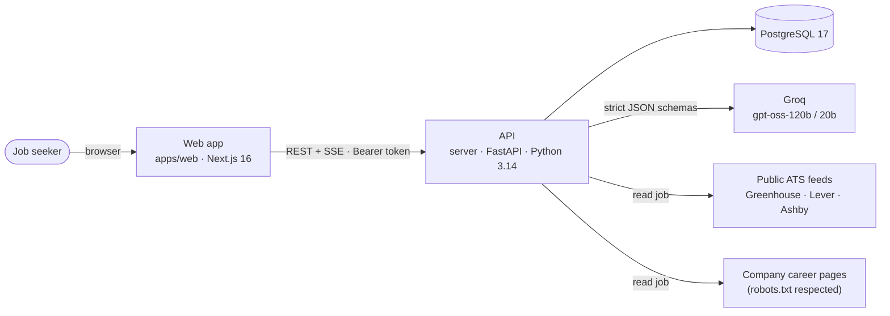
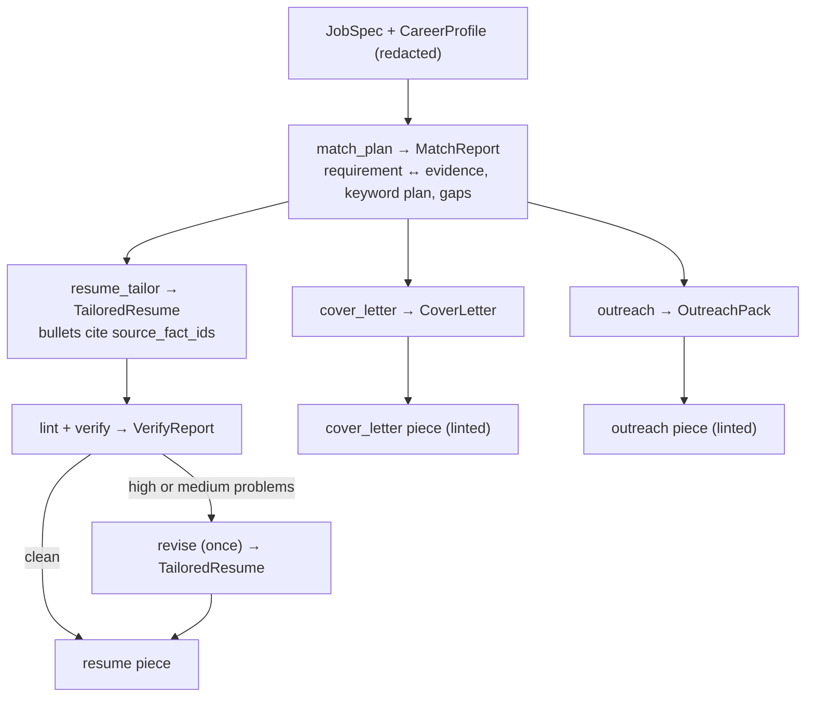
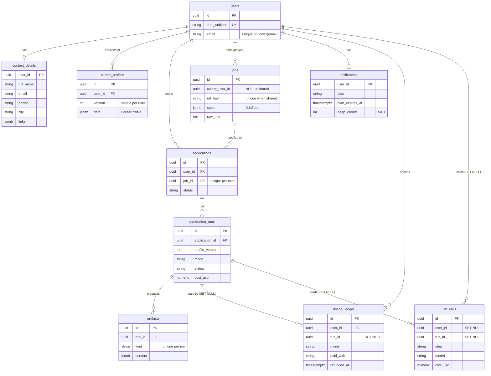
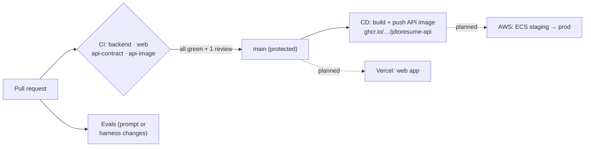

# Architecture (as built)

This describes the system that exists in this repository today, module by module. The original design document,
including everything still planned (AWS, workers, S3, the browser extension, payments), is
[docs/ARCHITECTURE.md](../ARCHITECTURE.md). Where the two differ, this file describes the code; the design file
describes the target.

## 1. System context



- **One API process type.** Everything (requests, the generation stream, rendering) runs in the FastAPI process.
  The design's SQS worker and separate fetcher service are not built yet.
- **Nothing is stored in object storage yet.** Uploaded resumes are parsed and discarded; PDFs and DOCX files are
  rendered on request (well under a second) instead of being stored.
- **The web app talks to the API directly** from the browser (CORS), with the sign-in token in an
  `Authorization: Bearer` header. There is no backend-for-frontend.

## 2. Backend layout

```
server/app/
  main.py             create_app(): settings → logging → database, Groq client, LLM semaphore, fetcher → middleware
                      → error handlers → routes (dev sign-in only when AUTH_MODE=dev)
  api/                router.py (all /v1 routes), health.py (/health, /health/ready), dev.py (POST /v1/dev/sign-in)
  core/               config, logging, errors, middleware (request id), db, auth, sse, text, env
  llm/                client, router (models + prices), schemas (every step's contract), pii, prompts/, style/, ledger
  features/<name>/    router.py → service.py → repository.py, plus schemas.py, models.py, dependencies.py
  cli/                dev_token, grant, openapi, concierge (Phase 0)
  models.py           imports every table model so Alembic sees them
server/migrations/    Alembic, 4 revisions
```

**Layering inside a feature.** `router.py` only parses the request and returns the response. `service.py` holds
the rules, raises domain errors (`app/core/errors.py`, never `HTTPException`) and decides when to commit.
`repository.py` only queries and never commits. `schemas.py` holds the API's request and response models (Pydantic);
`models.py` holds the tables (SQLAlchemy classes, always named `...Row`). Database rows never leave a service.

**Cross-feature reads.** Features use each other's repositories (e.g. rendering reads generation and profiles).
The one module that reads every table is `features/data_export/repository.py`, deliberately: the export must cover
everything, and a test fails when a new table is added without deciding whether it's personal data.

### Core modules

| Module | What it does |
|--------|--------------|
| `core/config.py` | Settings from environment variables (and a gitignored `.env` locally). Refuses `AUTH_MODE=dev` in staging and production, and `AUTH_MODE=jwks` without a JWKS URL and issuer |
| `core/logging.py` | One-line logs locally, one JSON object per line elsewhere. Every line carries the request id. Emails and phone numbers are redacted. Writes go through a queue so a slow log sink never blocks the event loop |
| `core/errors.py` | Every error, including validation errors and crashes, becomes `{"code", "message", "details"}`. Domain errors: 401, 402, 403, 404, 409, 413, 422, 429, 502, 503 |
| `core/middleware.py` | Request ids (`X-Request-ID` in and out) and one access-log line per request, as plain ASGI so streaming responses aren't buffered |
| `core/db.py` | Async SQLAlchemy engine and sessions, constraint naming convention, `release_connection()` (commit before slow outside work so a connection isn't held during an AI call) |
| `core/auth.py` | Token verification only: dev tokens (HS256, local and test) or JWKS (EdDSA/ES256/RS256 from the sign-in provider). Returns a `Principal`; the users feature turns it into a row |
| `core/sse.py` | Server-Sent Events formatting, a keep-alive comment every 15 s, and a cancellation-safe wrapper |

### Features and their endpoints

| Feature | Endpoints | Tables |
|---------|-----------|--------|
| users | `GET /v1/me` (creates the user on first request), `DELETE /v1/me` (everything cascades) | `users` |
| profiles | `POST /v1/profile/resume` (PDF/TXT/MD ≤ 5 MB → new profile version), `GET/PUT /v1/profile` (versioned, optimistic locking via `base_version`), `GET/PUT /v1/profile/contact` | `career_profiles`, `contact_details` |
| jobs | `POST /v1/jobs` (text or link), `GET /v1/jobs/{id}` | `jobs` |
| applications | `POST /v1/applications`, `GET /v1/applications` (keyset pages), `GET /v1/applications/{id}` (with the latest pack, typed) | `applications` |
| generation | `POST /v1/applications/{id}/generate` (SSE stream) | `generation_runs`, `artifacts` |
| rendering | `GET /v1/applications/{id}/files/{resume\|cover-letter}.{pdf\|docx}`, `GET /v1/applications/{id}/ats-check` | none (rendered on request) |
| billing | `GET /v1/me/plan` | `entitlements`, `usage_ledger` |
| data_export | `GET /v1/me/export` | reads all |
| api (dev) | `POST /v1/dev/sign-in` (only with `AUTH_MODE=dev`) | none |

Every protected route declares `user: CurrentUser` (`features/users/dependencies.py`). Ownership is checked in
every query (someone else's application is "not found", never "forbidden", so ids can't be probed).

## 3. The LLM layer (`server/app/llm/`)

All AI calls go through `GroqLLM.run_step()` in `client.py`. A step is: a name, a Pydantic output model, a model
configuration, and blocks of input (some marked as a cacheable prefix).

- **Strict structured output.** Each step's output schema is sent as Groq `json_schema` with `strict: true`, and the
  reply is validated by Pydantic. A schema mismatch is retried once; anything else fails the step.
- **Model routing** (`router.py`), by step and mode:

  | Step | Deep | Quick |
  |------|------|-------|
  | resume_parse, jd_extract | gpt-oss-120b, effort low | gpt-oss-20b, low |
  | match_plan, resume_tailor, verify, revise, cover_letter | gpt-oss-120b, medium | gpt-oss-20b, medium |
  | outreach | gpt-oss-120b, low | gpt-oss-20b, low |

  Reasoning text is never downloaded (`include_reasoning: false`); reasoning tokens are still billed as output, so
  each step's `max_completion_tokens` leaves room for them. Prices live in the same file (one table).
- **PII guard** (`pii.py`). The profile the AI sees has the user's email, phone and links replaced by placeholders
  (`{{EMAIL}}`, `{{LINK_0}}`…). Before every request, the outgoing text is checked for the user's real contact details,
  and the call fails closed if any appear. Placeholders are restored only when documents are rendered or shown.
- **Prompts** (`prompts/*.md`): one global policy plus one file per step. A prompt's version is its content hash,
  recorded with every call, so eval results and production calls can be traced to the exact prompt.
- **Linters** (`style/`): deterministic checks on generated text (banned phrases, skills the profile doesn't support,
  pronouns, length). A high-severity finding triggers the revise step.
- **Budget and concurrency.** Each request gets its own spend cap (`LLM_RUN_BUDGET_USD`, default $0.50), and one
  semaphore per process caps simultaneous Groq requests (`LLM_MAX_CONCURRENCY`, default 8).
- **Cost ledger** (`ledger.py`): one `llm_calls` row per paid call (step, model, prompt version, tokens, cost,
  latency). Rows hold no personal data and survive account deletion (the user link becomes NULL).

## 4. Generation (`features/generation/`)



- `pipeline.py::stream_pack` is the only orchestrator. It yields each piece as soon as it's ready; `generate_pack`
  collects the same stream for the eval harness and CLI. The match step runs first so the shared prompt prefix
  (policy + profile) is cached by Groq for the three parallel branches.
- `service.py` has two phases. `prepare` runs inside the request: it checks ownership and that a profile exists,
  refuses a second run while one is running (409, unless it's over 10 minutes old), spends one pack (section 6) and creates
  the run, all in one transaction. `stream` runs after the response starts: each piece is saved before its event is
  sent, so a dropped connection loses nothing.
- **Clean-up is shielded.** When the browser disconnects, the server cancels the stream task. The final step (close
  the run, give the pack back if there's no resume, record every AI call) runs inside `anyio.CancelScope(shield=True)`
  so it always completes. Tests prove this with a simulated disconnect.
- Events, in order: `run`, `match_report`, then `resume`, `cover_letter`, `outreach` as they finish, then `done` or
  `error`. Their payloads are the same models as `GET /v1/applications/{id}` → `pieces` (typed in the OpenAPI schema).

## 5. Jobs (`features/jobs/`)

- **Pasted text** goes straight to the `jd_extract` step and is stored privately (`owner_user_id` = the user).
- **Links** are canonicalised (`urls.py`: lower-case host, no tracking parameters or fragments), then read in order
  of reliability (`ingestion/reader.py`):
  1. the public ATS feed for Greenhouse, Lever and Ashby job pages (`ingestion/ats.py`);
  2. schema.org `JobPosting` data embedded in the page (`ingestion/html.py`);
  3. the page's readable text.
- **Never fetched** (`policy.py`): LinkedIn, Indeed, Naukri, Glassdoor, Monster, foundit, Instahyre and Wellfound.
  The user is asked to paste the text (and later the browser extension reads the page they're on).
- **SSRF-safe fetcher** (`ingestion/fetch.py`): http/https on standard ports only; every hostname resolved and
  refused if non-public (private, loopback, link-local such as 169.254.169.254, multicast, reserved); redirects followed
  by hand (max 3, each checked); 10 s and 3 MB limits; no cookies; robots.txt respected for ordinary pages.
- **Shared cache.** A job read from a public link is stored once (`owner_user_id` NULL, partial unique index on the
  URL hash) and reused by every user; a concurrent first read is handled by the unique index.

## 6. Plans and metering (`features/billing/`)

- Plans are code (`plans.py`): **Free** (3 Quick packs per calendar month in UTC, plus Deep credits: 1 at sign-up),
  **Sprint pass** (7 days), **Pro monthly** (30 days) and **Pro quarter** (90 days). Paid plans include Deep, up to 100
  packs in any 7 days (fair use). A paid plan past its expiry counts as Free.
- `entitlements` holds the plan, its expiry and the Deep credit balance (created on first use). `usage_ledger` holds
  one row per pack started, how it was paid for (`free_allowance`, `deep_credit`, `plan`) and whether it was refunded.
- **Spending** happens in `prepare`, under a `SELECT … FOR UPDATE` lock on the user's entitlement row, so two
  simultaneous Generate presses can't both spend the last pack (a test proves it fails without the lock).
- **Refunds:** a run that ends without the resume (the AI failed, the browser left) gives its pack back, even if
  other pieces finished. The error event tells the user.
- Ledger rows keep their history when a run or application is deleted (`run_id` SET NULL), so deleting an application
  never gives packs back. Deleting the account removes everything.
- Errors: `402 quota_exceeded`, `402 upgrade_required`, `429 fair_use_limit` (with `Retry-After`).
- Plans and credits are granted today with `python -m app.cli.grant`; payment webhooks will call the same
  `BillingService.grant_plan` / `add_deep_credits`.

## 7. Rendering and the ATS check (`features/rendering/`)

- **The AI writes references, not layout.** `TailoredResume` points at profile entries by id; `document.py` takes
  titles, companies, dates and certification names from the profile itself, so the AI can't change them.
- **PDF** (`typst_renderer.py`): Typst templates in `templates/` (resume: classic, modern; cover letter), fed JSON.
  System fonts are ignored and the document date is fixed, so output is identical on every machine. The fit-to-page
  loop drops the least relevant bullet (by the match report's relevance scores, oldest entry first) until the PDF fits
  the page limit (1 page under ~8 years of experience in US-style markets, otherwise 2; the user's preference wins).
- **DOCX** (`docx_renderer.py`): the same render data, Word's built-in heading and list styles, no tables or text
  boxes, clickable links. It always carries the same bullets as the PDF.
- **ATS round-trip check** (`ats_roundtrip.py`), run on every file: two independent readers (pdfminer.six and pypdf
  for PDFs; python-docx and a raw XML walk for DOCX) must agree; section headings found in order; name, email and phone
  near the top; dates parse and run newest first; no ligature, private-use or unmapped glyphs; no text under 8 pt.
  Keyword and must-have coverage are measured in the extracted text and reported, but never block.
- A failed check never blocks a download (it's the user's document): the response carries `X-ATS-Check: failed`,
  `GET …/ats-check` explains why, and the server logs a warning.
- File names look like `Jordan-Rivera-Resume-Figma.pdf` (Unicode kept, with an ASCII fallback in the header).

## 8. Data model



Contact details are a separate table on purpose: it's the part that must never reach the AI. Profiles are append-only
(an edit is a new version), and a run records the exact version it was written from, so downloads always render
against that version. Migrations are tested by the test suite (built from scratch every run) and CI runs
`alembic check` to catch models and migrations drifting apart.

## 9. Web app (`apps/web`)

- **Next.js 16** (App Router, Turbopack, Cache Components), Tailwind v4, shadcn/ui on Radix, TanStack Query.
- **Routes:** `/sign-in`; signed-in pages under `src/app/(app)/` (`/applications`, `/applications/new`,
  `/applications/[id]`, `/profile`, `/account`) wrapped by a session gate and the app shell; an error boundary per page.
- **Feature folders** (`src/features/<name>/`): `api.ts` (TanStack Query hooks) plus `components/`.
- **Typed client.** `lib/api/client.ts` wraps `openapi-fetch` with the types generated into `packages/api-types` from
  the API's OpenAPI schema. CI fails if those types are stale.
- **Session.** A dev token from `POST /v1/dev/sign-in` kept in localStorage (`lib/session.ts`). Signed-in pages
  render only in the browser for that reason, which is why instant-navigation validation is opt-in in
  `next.config.ts`. Better Auth (cookies) will change this.
- **The generate stream** is read with `fetch()` (EventSource can't send the token) and parsed by `lib/sse.ts`. Each
  application's run lives in `features/generate/generation-runs.ts`, outside React, so leaving the page doesn't cancel
  the run on the server.
- **What you preview is what you download.** The resume preview is the PDF from the API; the ATS panel shows the
  measured check and the extracted text.
- **Placeholders** in AI text are filled for display and copying by `lib/placeholders.ts`, mirroring the server.
- **Design system:** `docs/design-system/tailor/` (tokens measured for WCAG contrast in light and dark mode; 40–44 px
  controls; status never shown by colour alone; reduced motion respected).

## 10. Security and privacy

| Concern | How it's handled |
|---------|------------------|
| Contact details and the AI | Placeholders in, real values only at render or display time; outgoing requests checked and blocked if they leak (section 3) |
| Sign-in | Token verification only in `core/auth.py`; dev tokens refused in staging/production by settings validation; the dev sign-in route isn't mounted outside dev mode; the API image defaults to `ENVIRONMENT=production`, so it fails closed |
| Ownership | Every query filters by the signed-in user; others' resources are 404 |
| SSRF | Fetcher checks (section 5); the planned isolated fetcher service adds network-level blocks |
| Scraping | Client-only sites are never fetched (`jobs/policy.py`) |
| Logs | Request ids; emails and phone numbers redacted; no request bodies logged |
| Downloads | `Cache-Control: private, no-store`; header-injection-safe file names |
| Data rights | `GET /v1/me/export` (everything, as JSON) and `DELETE /v1/me` (cascades); the AI-cost ledger keeps anonymous rows |
| Secrets | Only in environment variables or the gitignored `.env`; `.env.example` has none |
| Supply chain | Locked dependencies (`uv.lock`, `pnpm-lock.yaml`), Dependabot weekly, images with provenance and an SBOM |

## 11. CI/CD



- **CI** (`.github/workflows/ci.yml`), required on `main`:
  - **backend**: ruff, `alembic upgrade head` + `alembic check`, then all pytest suites against real Postgres. Database tests must run, not skip.
  - **web**: typecheck, lint, Vitest, `next build`.
  - **api-contract**: regenerates the OpenAPI schema and TypeScript types; fails on any difference.
  - **api-image**: builds the Docker image, checks it refuses dev sign-in in production, serves `/health` and renders a PDF.
- **Evals** (`evals.yml`): on prompt, schema or harness changes; the cost estimate always runs, and the live smoke eval
  runs with hard gates when the `GROQ_API_KEY` secret is set.
- **CD** (`cd.yml`): on `main` and `v*` tags, the API image goes to GitHub Container Registry (`sha-…`, `latest`,
  versions). Deploying to AWS and Vercel is in [WORK_LEFT.md](WORK_LEFT.md).
- **Branch protection** on `main`: pull requests only, all four CI checks green and up to date, one approving review,
  no force pushes or deletion. Admins can bypass in an emergency. Details in [CONTRIBUTING.md](../../CONTRIBUTING.md).

## 12. Decisions worth knowing

| Decision | Why | Revisit when |
|----------|-----|--------------|
| Groq (gpt-oss) as the only AI provider | Cost per pack in cents, fast, strict JSON schemas ([ADR-0001](../adr/ADR-0001-llm-provider-groq.md)) | Evals show a quality gap |
| SSE over `fetch()` instead of WebSockets or polling | One-directional, works through proxies, carries the auth header | Never, likely |
| Render on request, store nothing | Deterministic and under a second; no stale files to invalidate | Editable artifact versions arrive (then store renders in S3) |
| Plans as code, ledger in Postgres | Simple, testable; payments only grant | Pricing experiments need runtime config |
| Typed pieces in the API | The web app gets real types for the pack; old rows that don't match are left out, never a 500 | Schemas change: add a migration for stored pieces |
| Dev sign-in endpoint | Lets the web app run before Better Auth | Better Auth lands (it stays dev-only) |
| No AWS yet | Prove the product locally first; the design is ready in docs/ARCHITECTURE.md | Closed beta |
